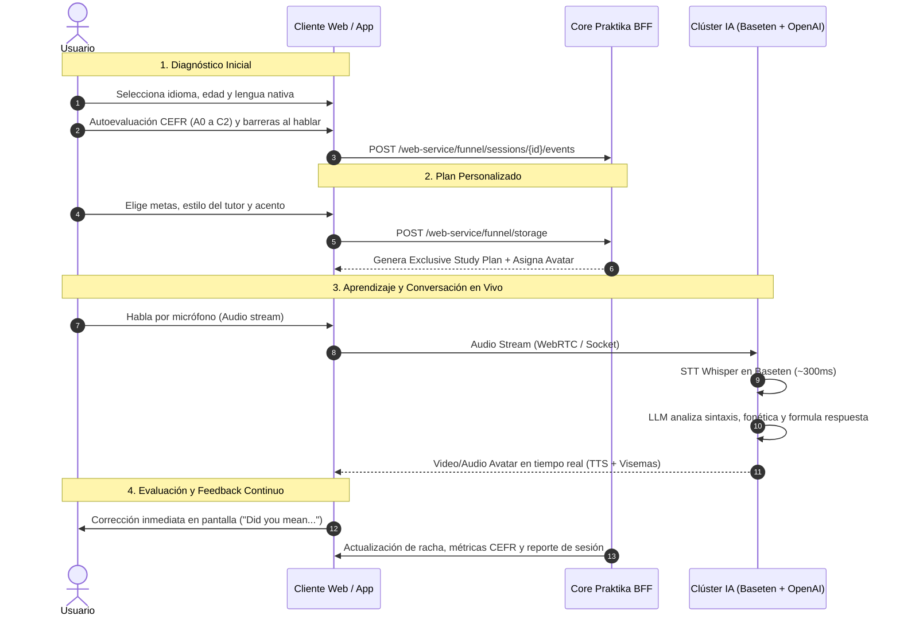

# Informe Técnico de Ingeniería Inversa: Arquitectura y Funcionamiento de Praktika.ai

**Fecha de análisis:** 18 de octubre de 2026  
**Objetivo:** Comprender la arquitectura de software, modelo de persistencia, metodología pedagógica y distribución de cómputo de Praktika.ai para servir de base técnica en el diseño del sistema propio MyPolyGloty OS (Plataforma de Idiomas).  
**Metodología:** Análisis estático de bundles de producción web (`start.praktika.ai`), desofuscación de grafos y esquemas Zod, e inspección de reportes de infraestructura y casos de estudio técnicos oficiales (Baseten, OpenAI). Sin ejecución invasiva ni extracción de assets propietarios.

---

## 1. ¿De qué está hecha? (Stack Tecnológico y Motores)

A través de la inspección estática del cliente web de onboarding (`https://start.praktika.ai/`) y el análisis de dependencias de producción, se confirmó la siguiente arquitectura:

### A. Frontend y Cliente Web
* **Empaquetador y Bundler:** **Vite** (evidenciado por la presencia de funciones helper de carga `__vite__mapDeps` y el manejador de recarga `vite:preloadError` en `assets/index-RFzVYR1b.js`).
* **Framework de Interfaz:** **React 18+** montado mediante `createRoot` (`assets/index-RFzVYR1b.js` línea 10). Emplea concurrencia moderna (`Suspense`), hooks nativos (`useSyncExternalStore`, `useLayoutEffect`, `useCallback`, `useMemo`) y contextos jerárquicos.
* **Sistema de Tipos y Validación de Estado:** **Zod** utilizado de forma exhaustiva para garantizar la integridad de todos los datos locales y de red (`assets/store-sRB5NsDq.js`).
* **Caché y Gestión de Peticiones:** **TanStack Query** (`QueryClient`, `MutationCache`, `QueryCache` instanciados en `assets/store-sRB5NsDq.js`).
* **Internacionalización (i18n):** **i18next** (`i18nextLng`, `<Trans>`, namespaces dinámicos `shared.common`, `translation`).
* **Observabilidad y Telemetría:** **Datadog RUM & Logs** (`datadoghq.com`, app ID `18a57dc0-368a-4397-91eb-8d072a0fc7fb`, servicio `web-app`, entorno `prod`).

### B. Capa de Red y Backend for Frontend (BFF)
* **Endpoints de Producción:** 
  * Primario: `https://core-prod-fast.praktika.ai/`
  * Failover / Redundancia: `https://core-prod-fast.praktika-ai.com/`
* **Manejo de Errores y Resiliencia:** Cliente HTTP propietario con reintentos automáticos (hasta 4 intentos en round-robin entre dominios) y tipado estricto de errores (`BffNetworkError`, `BffBadRequestError`, `BffUnauthorizedError`, `BffRateLimitedError`, `BffServerError`).

### C. Motores de Inteligencia Artificial (Nube)
* **Speech-to-Text (STT):** Modelos **Whisper** alojados sobre infraestructura de inferencia de ultra-baja latencia en **Baseten**. Esta arquitectura permitió a Praktika reducir la latencia de transcripción de voz de 1,500 ms a **~300 ms**, reduciendo los costos de cómputo en un 50% (evidencia: caso de estudio técnico oficial de Baseten con el CTO Anton Marin).
* **Razonamiento y Tutores Conversacionales (LLM):** Modelos **OpenAI (GPT-4 / GPT-5 series)** integrados en una arquitectura multi-agente donde cada tutor IA tiene un trasfondo cultural, acento, personalidad y memoria a largo plazo adaptada a los niveles del marco CEFR (evidencia: caso de estudio oficial de OpenAI sobre Praktika).
* **Streaming de Avatares:** Entrega multimedia en tiempo real mediante protocolos de baja latencia (WebRTC y pipelines Speech-to-Video) que sincronizan el flujo de audio del sintetizador (TTS) con visemas y animación facial.

### D. Aplicaciones Móviles
* **Android:** Paquete `ai.praktika.android` (tamaño ~270 MB, orientado a streaming de modelos y assets multimedia).
* **iOS:** App ID `1624701477`.

---

## 2. ¿Cómo guarda un "proyecto", sesión o progreso del usuario?

Praktika no implementa un "archivo de proyecto" monolítico descargable; en su lugar, implementa un **sistema de estado híbrido de triple capa** (Memoria React + LocalStorage resiliente con cookies + Vault remoto en el servidor).

### Procedimiento Detallado (Evidencia en `assets/store-sRB5NsDq.js`):

1. **Gestor de Almacenamiento Local (`function b(key, schema, options)`):**
   * Cada elemento de estado se asocia a un esquema Zod estricto.
   * Si el usuario escribe datos, se guardan en `localStorage`.
   * **Mecanismo de Resiliencia (Cookie Fallback):** Si el navegador tiene políticas restrictivas o el usuario limpia el almacenamiento local, el sistema escribe simultáneamente una cookie Lax con vencimiento a **365 días** (`sameSite: "lax"`, `expires: Date.now() + 31536000000`). Si `localStorage` falla, se recupera de la cookie.

2. **Inventario de Claves Guardadas:**
   * `funnel-current-step`: El paso exacto del flujo donde se encuentra el usuario.
   * `funnel-quiz-answers`: Objeto JSON validado con el esquema `fo` que almacena:
     * `currentStudyLang`: Idioma objetivo.
     * `cefrLevelExtended`: Nivel en escala CEFR (`A0_1`, `A0_2`, `A1_1`, `A1_2`, `A2_1`, `A2_2`, `B1_1`, `B1_2`, `B2_1`, `B2_2`, `C1_1`, `C1_2`, `C2_1`, `C2_2`).
     * `goalToLearn`: Metas (`career`, `travel`, `media`, `personalDevelopment`, etc.).
     * `speakingFrustration`: Barrera principal (`cant-understand-fast-speech`, `mind-goes-blank`, `sound-like-beginner`, `translate-in-head`).
     * `interests`, `learningType`, `preferredAccent`, `tutorStyle`, `practiceStyle`.
   * `funnel-auth`: Rama de autenticación (`branch`: `NEW` | `RETURNING_NO_SUB` | `RETURNING_ACTIVE`), método (`email`, `google`, `apple`) y `userId`.
   * `funnel-order`: Selección de producto, `orderId`, proveedor de pago (`stripe`) y estado (`pendingPurchase`).
   * `praktika-p`: Identificador permanente de hardware/navegador con prefijo UUID `webf_perm_...`.
   * `praktika-s`: ID de sesión activa.

3. **Capa Servidor (El "Vault" Remoto):**
   * Cuando se registran respuestas críticas, se emite una petición a:
     * `POST /web-service/funnel/storage` (Guarda el estado completo en el servidor y devuelve un token de bóveda).
     * `POST /web-service/funnel/storage/retrieve` (Restaura la sesión mediante `postPayment.vault` si el usuario regresa de una pasarela de pago o cambia de pestaña).
     * `POST /web-service/funnel/sessions/{session_id}/events` (Registra atómicamente cada respuesta del cuestionario con evento `web_funnel_quiz_question_answered`).

---

## 3. Funcionamiento Paso a Paso: Diagnóstico, Plan, Aprendizaje y Evaluación

El ciclo de vida del estudiante está modelado como una máquina de estados finita evidenciada en los arrays `flowIds` y `Y` (`flowIds-PLu0agwn.js` e `index-RFzVYR1b.js`):



### Detalle de las 4 Fases:

1. **Fase 1: Diagnóstico Integral:**
   * **Demografía básica:** Idioma meta, idioma nativo, edad, nombre.
   * **Nivel Lingüístico Técnico:** Autoevaluación graduada en 14 subniveles CEFR (`A0_1` hasta `C2_2`).
   * **Pruebas de Autopercepción:** Medición de capacidad para presentarse (`introduce-yourself`), sostener una conversación fluida (`maintain-conversation`) y comprensión auditiva de hablantes nativos (`understand-native-speakers`).
   * **Diagnóstico Emocional/Bloqueo Mental:** Identificación de la fricción cognitiva principal: mente en blanco, traducir mentalmente palabra por palabra o miedo al ridículo (`speaking-frustration`).

2. **Fase 2: Generación del Plan Personalizado:**
   * **Objetivos y Plazos:** Frecuencia de estudio (`practice-per-day`), horizonte temporal (`how-soon`).
   * **Calibración Pedagógica:** Elección del estilo de corrección del tutor (corrección inmediata de cada error vs. conversación libre con reporte al final), nivel de reto (`tutors-challenge`) y acento predilecto (americano, británico, australiano, etc.).
   * **Procesamiento:** Pantalla `processing` donde el servidor ensambla el plan personalizado (`exclusive-study-plan`) y empareja al usuario con el tutor avatar óptimo (`choose-a-tutor`).

3. **Fase 3: Proceso de Aprendizaje y Enseñanza (Conversación Dinámica):**
   * Se inicia un escenario conversacional o juego de roles contextual (`roleplay-situations`).
   * El usuario envía voz por el micrófono.
   * **Pipeline de IA:**
     1. El stream llega al clúster de **Baseten**, transcribiéndose con Whisper en ~300 ms.
     2. El texto transcrito se evalúa en **OpenAI** con un system prompt que incluye la memoria histórica del estudiante y los objetivos pedagógicos.
     3. El LLM genera la respuesta conversacional y un payload estructurado de correcciones.
     4. El motor de voz genera el audio y los parámetros de visemas faciales para el avatar.

4. **Fase 4: Evaluación y Resultados:**
   * **Corrección en Vivo:** Si el estudiante comete un desliz gramatical, el avatar responde conversacionalmente mientras la interfaz destaca el error en un recuadro de chat (ejemplo extraído del DOM: *«I’m bad to speak English»* $\rightarrow$ *«Do you mean: "I'm bad at speaking English"?»*).
   * **Métricas de Rendimiento:** Resumen post-sesión con palabras nuevas, precisión gramatical, porcentaje de fluidez y progreso hacia el siguiente nivel CEFR.

---

## 4. ¿Dónde corre cada función Pro o superior?

| Función / Característica | ¿Dónde corre? | Evidencia / Justificación Técnica |
|---|:---:|---|
| **Motor de Transcripción (STT)** | **Nube (Baseten)** | Confirmado en la arquitectura técnica oficial de Baseten: Whisper alojado en clústeres GPU dedicados para alcanzar ~300 ms de latencia. No se ejecuta en el dispositivo cliente. |
| **Generación de Respuestas y Tutores IA (LLM)** | **Nube (OpenAI)** | Confirmado en el caso de estudio de OpenAI: modelos GPT-4 / GPT-5 series con memoria a largo plazo que operan mediante API server-side. |
| **Verificación de Licencia y Estado Pro** | **Nube (Servidor Praktika + Stripe)** | El cliente solo contiene la lógica de redirección y captura de estado (`funnel-order`, `provider: "stripe"`, endpoints `/web-service/funnel/sessions/...`). La autorización de funciones Pro la emite el servidor tras verificar webhooks de pago. |
| **Renderizado Neuronal de Avatares** | **Nube (Streaming WebRTC)** | Los modelos generativos de video de rostro y sincronización labial operan en granjas de GPU en la nube y se transmiten como video comprimido hacia el cliente. |
| **Almacenamiento del Historial y Memoria** | **Nube (BFF Database)** | La memoria contextual persistente de los tutores reside en la base de datos central de Praktika, no en el dispositivo del usuario. |
| **Captura de Micrófono y Reproducción** | **Local (Dispositivo)** | Captura de hardware vía Web Audio API / MediaStream en el navegador o AudioRecord nativo en Android/iOS. |
| **Validación de Formularios y Cuestionarios** | **Local (Dispositivo)** | Validación en cliente con bibliotecas Zod compiladas en el bundle (`store-sRB5NsDq.js`). |

---

## 5. Tabla: Qué se pudo revisar y qué no

| Parte o Función | Estado | Motivo |
|---|:---:|---|
| **Estructura Frontend y Frameworks (React, Vite, Zod, Datadog)** | ✅ Confirmado con evidencia | Inspección directa del código estático y chunks JS descargados desde `start.praktika.ai`. |
| **Flujo de Diagnóstico y Preguntas (60+ etapas y niveles CEFR)** | ✅ Confirmado con evidencia | Extraído de los arrays `flowIds` y los esquemas Zod en `store-sRB5NsDq.js`. |
| **Mecanismo de Persistencia y Redundancia (LocalStorage + Cookies)** | ✅ Confirmado con evidencia | Inspección de la función `b()` y almacenamiento redundante de 365 días en `store-sRB5NsDq.js`. |
| **Infraestructura de Inferencia STT (Whisper en Baseten, ~300ms)** | ✅ Confirmado con evidencia | Publicaciones de arquitectura y caso de estudio técnico oficial de Baseten con el CTO de Praktika. |
| **Modelos de Lenguaje y Arquitectura Multi-Agente (OpenAI)** | ✅ Confirmado con evidencia | Caso de estudio oficial de ingeniería de OpenAI sobre la arquitectura de Praktika. |
| **Pasarela de Cobro y Checkout Pro (Stripe)** | ✅ Confirmado con evidencia | Esquema de órdenes Zod (`provider: stripe`, `funnel-order`) en bundles estáticos. |
| **Lógica Interna del Backend y Base de Datos Propietaria** | ❌ No se puede ver | Código cerrado que se ejecuta 100% en servidores remotos privados de Praktika. |
| **Prompts de Sistema de los Tutores y Pesos de Redes Neuronales** | ❌ No se puede ver | Protegidos en el backend de inferencia; no se exponen al cliente. |
| **Modelo Neuronal Propietario de Sincronización Labial** | 🟡 Parcial | Se constata que se entrega vía streaming multimedia, pero el código de inferencia gráfica reside en servidores de GPU privados. |
| **Binario Nativo de Android (`ai.praktika.android`)** | 🟡 Parcial | Identificado ID de paquete, permisos y tamaño (~270 MB), pero no se desensambló para respetar la regla de no ejecutar ni vulnerar protecciones. |

---

## 6. Plan para MyPolyGloty OS: Arquitectura de la Herramienta Propia

Para construir una plataforma de aprendizaje de idiomas interactiva inspirada en los puntos fuertes de Praktika (pero con control total y formato abierto), se propone el siguiente diseño técnico.

### A. Estructura del Formato de Proyecto (`project.json`)

El archivo `.json` del proyecto guardará todo el estado de una lección, los datos del usuario, las intervenciones fonéticas y los nodos de audio/video:

```json
{
  "version": "1.0.0",
  "project_metadata": {
    "project_id": "proj_learn_es_001",
    "created_at": 1771286400,
    "target_language": "en-US",
    "native_language": "es-ES",
    "cefr_level": "B1_2",
    "tutor_profile": {
      "tutor_id": "tutor_sophia",
      "accent": "en-US-Standard",
      "voice_model": "tts_neural_v2",
      "pedagogical_strictness": "immediate_correction"
    }
  },
  "student_profile": {
    "student_id": "usr_9981",
    "learning_goals": ["job_interview", "fluency"],
    "known_weaknesses": ["prepositions", "past_perfect"]
  },
  "timeline_events": [
    {
      "event_id": "evt_001",
      "timestamp_ms": 1250,
      "speaker": "tutor",
      "transcript": "Hello! How did your job interview go yesterday?",
      "audio_asset": "assets/audio/tutor_evt_001.opus",
      "avatar_animation": {
        "video_asset": "assets/video/avatar_evt_001.mp4",
        "viseme_track": "assets/visemes/viseme_001.json"
      }
    },
    {
      "event_id": "evt_002",
      "timestamp_ms": 4800,
      "speaker": "student",
      "raw_audio_asset": "assets/audio/student_evt_002_raw.wav",
      "processed_audio_asset": "assets/audio/student_evt_002_norm.wav",
      "transcript_stt": "It was good, but I was bad to explain my experience.",
      "evaluation": {
        "score_fluency": 0.78,
        "errors_detected": [
          {
            "type": "grammar",
            "original_segment": "bad to explain",
            "suggested_correction": "bad at explaining",
            "explanation": "The adjective 'bad' takes the preposition 'at' followed by a gerund (-ing)."
          }
        ]
      }
    }
  ],
  "session_summary": {
    "duration_seconds": 185,
    "total_turns": 6,
    "words_spoken": 142,
    "accuracy_score": 0.84
  }
}
```

---

### B. Rol y Comandos de FFmpeg en Cada Acción de MyPolyGloty OS

FFmpeg será el motor multimedia local para preparar el audio del usuario antes del envío al STT, normalizar niveles, generar clips de video y empaquetar el informe final:

#### 1. Preparación y Extracción de Audio del Usuario para Inferencia STT (Whisper/Voz)
* **Objetivo:** Convertir cualquier grabación de micrófono (habitualmente WebM o Opus desde el navegador) a un formato WAV Mono de 16 kHz, estándar óptimo para Whisper con mínima latencia y menor tamaño de subida.
* **Comando FFmpeg:**
  ```bash
  ffmpeg -y -i input_student_raw.webm -vn -ar 16000 -ac 1 -c:a pcm_s16le output_stt_ready.wav
  ```
* **Acción técnica:** Elimina pistas de video (`-vn`), remuestrea a 16 kHz (`-ar 16000`), reduce a 1 canal mono (`-ac 1`) y codifica en PCM lineal de 16 bits sin compresión con pérdida.

#### 2. Reducción de Ruido y Normalización EBU R128 (Audio Limpio)
* **Objetivo:** Normalizar el volumen de la voz del estudiante para que el análisis de tono y pronunciación no se distorsione si el micrófono estaba muy bajo o saturado.
* **Comando FFmpeg:**
  ```bash
  ffmpeg -y -i output_stt_ready.wav -af "loudnorm=I=-16:TP=-1.5:LRA=11,afftdn=nf=-25" output_student_clean.wav
  ```
* **Acción técnica:** Aplica el filtro `loudnorm` para estandarizar el nivel de sonoridad integrada y `afftdn` (FFT denoiser) para atenuar ruido de fondo de ventiladores o ambiente.

#### 3. Segmentación para Análisis de Fonemas Específicos
* **Objetivo:** Recortar automáticamente el fragmento de audio exacto donde el estudiante pronunció una palabra con error para permitirle escuchar sólo esa palabra y compararla con el nativo.
* **Comando FFmpeg:**
  ```bash
  ffmpeg -y -ss 00:00:03.250 -to 00:00:04.100 -i output_student_clean.wav -c copy snippet_error.wav
  ```
* **Acción técnica:** Extracción por corte preciso en milisegundos (`-ss` y `-to`) sin re-codificación (`-c copy`) para ejecución instantánea.

#### 4. Sincronización del Audio del Avatar (TTS) con el Video en Bucle
* **Objetivo:** Tomar el archivo de voz generado por el sintetizador (TTS) y fusionarlo con el clip de video de animación/avatar en bucle, asegurando que el video dure exactamente lo que dura la frase.
* **Comando FFmpeg:**
  ```bash
  ffmpeg -y -loop 1 -i avatar_neutral_loop.mp4 -i tutor_voice_tts.mp3 -c:v libx264 -tune stillimage -c:a aac -b:a 128k -pix_fmt yuv420p -shortest tutor_response_clip.mp4
  ```
* **Acción técnica:** Repite el video base en bucle (`-loop 1`) hasta la duración exacta del audio TTS (`-shortest`), garantizando compatibilidad web/móvil con formato de píxeles `yuv420p`.

#### 5. Exportación del Informe de Sesión Multimedia en Video para el Estudiante
* **Objetivo:** Compilar un video resumen que combine la conversación completa, el avatar y sobreimprima las correcciones de texto en subtítulos para que el usuario pueda repasar su lección offline.
* **Comando FFmpeg:**
  ```bash
  ffmpeg -y -i tutor_response_clip.mp4 -vf "subtitles=corrections.srt:force_style='FontSize=20,PrimaryColour=&H00FFFFFF,OutlineColour=&H007429FF,BorderStyle=3'" -c:a copy session_review.mp4
  ```
* **Acción técnica:** Quema en el video los subtítulos de feedback estilizados con color morado de resalte, sin alterar la pista de audio.
