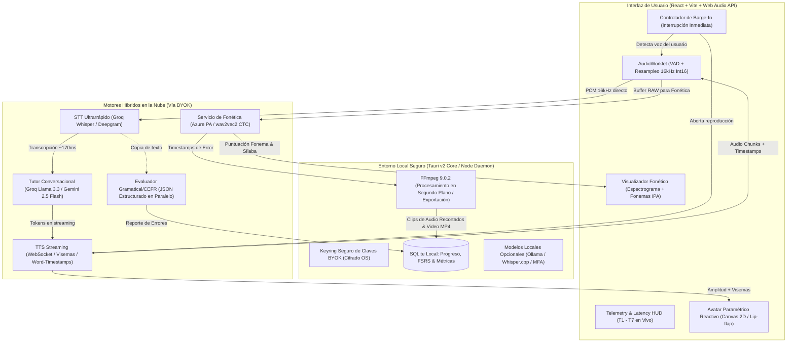
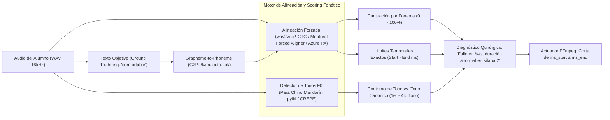

# Plan Maestro de Implementación: MyPolyGloty OS (Versión 2.0)

**Proyecto:** MyPolyGloty OS — Plataforma Conversacional de Idiomas Local-First, de Alto Rendimiento y Análisis Fonético Real  
**Fecha de Revisión:** Octubre 2026 (Refactorizado tras auditoría técnica senior - Veredicto 66/100 $\rightarrow$ V2.0 de Grado de Producción)  
**Objetivo Estratégico:** Construir una alternativa superior a Praktika y Speak eliminando la deuda de costos de streaming en la nube, garantizando un presupuesto de latencia E2E estricto con telemetría visible, un motor fonético quirúrgico científicamente viable (alineación forzada y pitch tracking de tonos) y persistencia modular sin exponer credenciales.

---

## 1. Matriz de Cambios Clave: Plan v1 vs. Plan v2

| Aspecto | Plan v1 (Veredicto 66/100) | Plan v2 (Corregido y Blindado) | Justificación Técnica |
|---|---|---|---|
| **Análisis Fonético** | "Análisis y corte fonético con FFmpeg superponiendo ondas" | **Motor de Alineación Forzada (wav2vec2 / MFA / Azure PA)** + FFmpeg como mero actuador de corte | FFmpeg no procesa fonemas ni detecta sílabas fallidas. Una onda de audio solo muestra amplitud, no calidad articulatoria. |
| **Sesgo de Whisper** | STT estándar con Groq Whisper | **Pipeline Dual:** Whisper para transcripción/gramática + Modelo acústico a nivel de fonema/CTC para pronunciación | Whisper es autorregresivo y "corrige" las palabras mal pronunciadas del alumno, ocultando el error fonético. |
| **Presupuesto Latencia** | "<500 ms" medido solo hasta inicio de LLM | **E2E Latency Budget (P50: ~750 ms, P95: ~1100 ms)** medido desde fin de turno de voz hasta audio emitido | El cálculo v1 omitía el tiempo de silencio de VAD (300 ms) y el tiempo de síntesis TTS (150-300 ms). |
| **FFmpeg en tiempo real** | FFmpeg en el loop de captura en vivo (`loudnorm`, `afftdn`) | **FFmpeg eliminado del loop caliente.** Captura y resampleo nativo en `AudioWorklet`. FFmpeg solo en background/exportación | Lanzar subprocesos FFmpeg añade 50-150 ms innecesarios; `loudnorm` requiere 2 pasadas y `afftdn` degrada a Whisper. |
| **Runtime y Seguridad** | Frontend web que llamaba FFmpeg del sistema mediante `child_process` (Incompatible) | **Arquitectura Desktop Híbrida (Tauri v2 / Node Local Host)** | Un navegador estándar no puede ejecutar binarios locales del sistema; almacenar API keys en frontend web las expone. |
| **Avatar Labial** | Three.js con morph targets 3D complejos en Sprint 3 | **Avatar Reactivo Paramétrico (Canvas 2D / Lip-flap por energía espectral)** en fase 1; 3D desacoplado | El rigging y modelado 3D consume semanas de arte y sobrecargaba los primeros sprints. |
| **Persistencia** | Un único archivo `project.json` para lecciones, estado y audio | **Separación clara:** `lesson.json` (portable/versionable Zod) + SQLite (progreso/métricas/FSRS) + Disco (audios) | Un JSON monolítico se corrompe y no escala con blobs de audio pesados. |
| **Chino Mandarín** | Tratado como texto regular en STT | **Extractor de F0 Pitch Contour** para verificación acústica de los 4 tonos + neutro | El STT omite los tonos del mandarín; sin análisis de tono fundamental no se puede evaluar fonética en chino. |
| **Mitigación de Riesgo** | Comparador fonético en Sprint 5 | **Spike Fonético Crítico en Sprint 1** probado contra un dataset de 20 audios controlados | Si el diferenciador principal falla, el proyecto fracasa. Debe validarse antes de construir el resto. |

---

## 2. Presupuesto de Latencia Extremo a Extremo (E2E Latency Budget)

La latencia conversacional real se mide desde el instante en que el usuario **deja de pronunciar la última sílaba** hasta que el **primer milisegundo de audio del tutor suena en los altavoces**.

```mermaid
gantt
    title Presupuesto de Latencia E2E en Cascada (Objetivo P50: 760 ms | Margen P95: 1150 ms)
    dateFormat X
    axisFormat %s ms
    section Detección
    VAD Silence Window (Adaptativo)       :crit, vad, 0, 250
    section Audio Client
    AudioWorklet Buffer & Resample 16kHz  :client, 250, 265
    section Red & STT
    Subida WebSocket + Groq Whisper Transcribe :stt, 265, 435
    section Inferencia LLM
    LLM TTFT (Groq Llama 3.3 70B / Prompt Cache) :llm, 435, 605
    Sentence 1 Chunking Buffer            :buf, 605, 630
    section Síntesis Voz
    TTS Time-To-First-Chunk (WebSocket)   :tts, 630, 730
    Playback Init & Audio Buffer          :play, 730, 760
```



### Desglose por Tramo y Metas de Rendimiento

| Tramo | Componente Técnico | Meta P50 | Límite P95 | Estrategia de Optimización |
|---|---|:---:|:---:|---|
| **T1: Fin de Turno (VAD)** | Silero VAD / Web Audio VAD | **250 ms** | 350 ms | Ventana dinámica: se reduce a 200 ms si el LLM detectó que la frase anterior era una pregunta cerrada. |
| **T2: Procesamiento Cliente** | `AudioWorklet` (Resampleo Float32 a Int16 16kHz) | **15 ms** | 25 ms | **Cero FFmpeg.** Operación puramente en memoria en hilo dedicado. |
| **T3: STT (Speech-to-Text)** | Groq Whisper / Deepgram Nova-2 streaming | **170 ms** | 240 ms | Streaming por chunks de audio o subida inmediata de buffer en memoria vía HTTP/2 persistente. |
| **T4: LLM (Time To First Token)** | Groq Llama 3.3 70B / Gemini 2.5 Flash / GPT-4o-mini | **170 ms** | 260 ms | System prompt caching pre-calentado; orquestación multi-agente asíncrona (el evaluador corre en paralelo, no bloquea al tutor). |
| **T5: Chunking de Oración** | Sentence-level Token Accumulator | **25 ms** | 40 ms | Disparo de síntesis de voz en el primer signo de puntuación (`,`, `.`, `?`, `!`, `;`) o al acumular 8 palabras. |
| **T6: TTS (First Audio Chunk)** | ElevenLabs Flash WebSocket / Kokoro local / Piper | **100 ms** | 180 ms | Conexión WebSocket permanente al motor TTS; decodificación progresiva en cliente con Web Audio API. |
| **T7: Reproducción** | AudioContext Buffer Source | **30 ms** | 55 ms | Doble búfer de audio en cliente para transiciones inaudibles entre frases. |
| **TOTAL E2E** | **Interacción Completa Turn-to-Ear** | **~760 ms** | **~1150 ms** | **Percepción humana fluida y natural.** |

> [!IMPORTANT]
> **Latency HUD Obligatorio (Telemetry First):** Desde el Sprint 0 se implementará un widget de telemetría flotante en la interfaz de desarrollo que mida y desglose los milisegundos de cada tramo (T1 a T7) en cada interacción. Cualquier cambio que aumente el P95 por encima de 1200 ms será considerado regresión bloqueante.

---

## 3. Arquitectura General y Runtime del Sistema

Para resolver la contradicción entre el acceso a binarios locales (FFmpeg, modelos locales) y la seguridad de las API keys sin depender de servidores en la nube de pago, el proyecto adopta una **Arquitectura de Escritorio / Host Local (Tauri v2 + Frontend Vite/React)**.



### Principios Fundamentales del Runtime:
1. **Ruta Crítica en Vivo Libre de FFmpeg:** La captura y el resampleo suceden 100% en el `AudioWorklet`. FFmpeg solo se invoca de manera asíncrona fuera de la interacción en vivo para cortar clips de palabras fallidas y exportar videos de resumen.
2. **Barge-In Nativo (Interrupción del Tutor):** Si el usuario empieza a hablar mientras el tutor reproduce audio, el VAD emite un evento inmediato que cancela el contexto de audio del tutor, detiene el socket de TTS y limpia los búferes de reproducción en <50 ms.
3. **Cancelación de Eco Acústico (AEC):** Activación estricta de las directivas `echoCancellation: true` y `noiseSuppression: true` de la API `getUserMedia`, aislando la entrada del micrófono del sonido emitido por los altavoces.
4. **Almacenamiento Desacoplado:**
   - `lesson.json` / `pack.json`: Contenido didáctico, diálogos y escenarios (portable, versionable en Git, validado con Zod).
   - `userdata.db` (SQLite): Estado de aprendizaje, histórico de latencias, curvas de repetición espaciada (FSRS) y metadatos de errores.
   - `/media/cache`: Almacenamiento local de grabaciones y clips de audio recortados.

---

## 4. El Spike Fonético: Diagnóstico Científico vs. Mito de FFmpeg

### El Error del Plan v1
El Plan v1 asumía que FFmpeg podía "analizar la fonética" y que superponer dos formas de onda (amplitud vs. tiempo) mostraría el error del estudiante. En acústica del habla:
* Dos hablantes nativos diciendo la misma palabra producen ondas de forma totalmente distinta (diferente tono, duración, resonancia tímbrica y formantes).
* La amplitud sólo indica volumen y presencia de consonantes oclusivas/vocales, **nunca calidad fonológica**.
* Whisper oculta el error fonético porque su decodificador busca la hipótesis lingüística más probable.

### La Solución Científica (Arquitectura del Spike Fonético)



### Especificación del Spike (Sprint 1)
* **Objetivo:** Demostrar con datos cuantitativos que el sistema identifica el fonema y la sílaba exacta del error con un F1-score > 0.85 antes de escribir una sola línea del comparador visual.
* **Dataset de Validación (Ground Truth Benchmark):** 20 audios controlados grabados con errores fonéticos deliberados y típicos de hispanohablantes aprendiendo inglés y mandarín:
  1. Confusión /b/ vs /v/ (*very* vs *berry*).
  2. Adición de vocal de apoyo /e/ (*speak* pronunciado como */es-pik/*).
  3. Vocales cortas vs largas (*sheep* vs *ship*, *bitch* vs *beach*).
  4. Reducción vocálica / schwa fallida (*comfortable*, *vegetable*).
  5. Desviación de tono en mandarín (Tono 1 plano vs Tono 4 descendente en *mā* vs *mà*).
* **Criterio de Éxito del Spike:**
  - Identificar la sílaba fallida y sus marcas de tiempo de inicio/fin con un margen de error menor a 50 ms.
  - Latencia de evaluación del fragmento < 400 ms en modo cloud o < 800 ms en modo local.

---

## 5. Plan de Sprints Reordenado (Fase 1 a Fase 3)

```mermaid
gantt
    title Cronograma Reestructurado MyPolyGloty OS v2.0
    dateFormat X
    axisFormat Sprint %s
    section Cimientos & Riesgo
    Sprint 0: Cimientos, Runtime Híbrido & Latency HUD :s0, 0, 1
    Sprint 1: Spike Fonético Crítico, VAD & Barge-In   :s1, 1, 2
    section Núcleo Conversacional
    Sprint 2: Orquestador Streaming, LLM Dual & BYOK    :s2, 2, 3
    Sprint 3: Avatar Paramétrico 2D & TTS Streaming    :s3, 3, 4
    section Pedagogía & Diferenciador
    Sprint 4: Diagnóstico CEFR (6 Bandas) & Roleplay PDF:s4, 4, 5
    Sprint 5: Comparador Fonético Visual, Pitch & FFmpeg:s5, 5, 6
    section Consolidación
    Sprint 6: Repetición Espaciada (FSRS), Offline & QA :s6, 6, 7
```

---

### Sprint 0: Cimientos, Runtime Híbrido y Latency HUD
* **Objetivo:** Establecer el entorno de escritorio seguro, canalizar el audio en `AudioWorklet` nativo y construir la instrumentación de latencia desde el día uno.
* **Entregables:**
  1. Inicialización del proyecto con **Tauri v2 + Vite + React + TypeScript**.
  2. Almacén seguro para API keys utilizando el Keyring del sistema operativo (previniendo filtraciones de credenciales BYOK).
  3. Módulo `AudioEngine`: Captura en `AudioWorklet` con resampleo directo a WAV 16kHz mono de 16 bits sin subprocesos.
  4. **Latency HUD:** Componente de interfaz en tiempo real que mide y grafica los tramos T1 a T7 con percentiles P50 y P95.
  5. Esquemas Zod independientes para `lesson.json` (contenido estático) y base de datos SQLite para métricas de usuario.
* **Definición de Terminado (DoD):** El entorno de escritorio compila, captura audio a 16 kHz sin latencia perceptible (<15 ms en `AudioWorklet`) y registra métricas de prueba en el Latency HUD.

---

### Sprint 1: Spike Fonético Crítico, VAD & Barge-In
* **Objetivo:** Despejar el mayor riesgo del proyecto. Probar y validar el motor de evaluación fonética con el benchmark de 20 audios y habilitar la interrupción natural del habla.
* **Entregables:**
  1. **Spike de Alineación y Diagnóstico Fonético:**
     - Implementación y comparativa de dos rutas:
       * Ruta A (Cloud API): Azure Pronunciation Assessment o Speechmatics.
       * Ruta B (Local / Open-Source): Modelo CTC Forzado (wav2vec2-xlsr-53 / torchaudio forced alignment).
     - Validación sobre el dataset de 20 audios controlados con cálculo de precisión por fonema y sílaba.
  2. Detección de pausas (VAD) adaptativa basada en Silero VAD / Web Audio Energy Gate.
  3. **Mecanismo de Barge-In:** Detección de inicio de habla del alumno para pausar inmediatamente la reproducción del tutor y limpiar los búferes de audio en <50 ms.
  4. Cancelación de eco acústico (AEC) validada con altavoces abiertos.
* **Definición de Terminado (DoD):** El spike fonético alcanza un F1-score $\ge 0.85$ localizando sílabas erróneas en el benchmark de prueba, y el alumno puede interrumpir al tutor en cualquier momento con cero acople de audio.

---

### Sprint 2: Orquestador Streaming, LLM Dual & Gestión BYOK
* **Objetivo:** Conectar el pipeline conversacional con latencia ultrabaja mediante streaming continuo y evaluación en segundo plano.
* **Entregables:**
  1. Integración de STT en streaming con Groq Whisper / Deepgram.
  2. **Orquestación Multi-Agente Asíncrona (Dual Pipeline):**
     * **Agente Tutor:** Genera la respuesta conversacional en streaming utilizando Groq Llama 3.3 70B o Gemini 2.5 Flash con System Prompt pre-cacheado.
     * **Agente Evaluador (Background):** Recibe la transcripción en paralelo y genera el análisis pedagógico en JSON estructurado sin ralentizar la respuesta del tutor:
       ```json
       {
         "cefr_band": "B1",
         "grammar_score": 85,
         "errors": [
           { "type": "tense", "original": "I go yesterday", "corrected": "I went yesterday", "explanation": "Uso de pasado simple con marcador 'yesterday'" }
         ]
       }
       ```
  3. **Sentence-Level Chunking:** Algoritmo acumulador de tokens que dispara la primera frase al TTS en el primer signo de puntuación ($,$, $.$, $?$).
  4. Panel de gestión BYOK para que el usuario configure sus claves personales de Groq, OpenAI o Anthropic.
* **Definición de Terminado (DoD):** Latencia Turn-to-First-Token del LLM inferior a 250 ms y emisión del primer chunk sintáctico a síntesis en <300 ms.

---

### Sprint 3: Avatar Paramétrico 2D & TTS Streaming
* **Objetivo:** Dar presencia visual al tutor mediante un avatar fluido de bajo coste computacional y síntesis de voz natural en streaming.
* **Entregables:**
  1. Pipeline de TTS en streaming vía WebSocket (ElevenLabs Flash / Edge-TTS streaming / Kokoro local).
  2. Decodificación de audio por fragmentos con la Web Audio API (evitando esperar a que termine de generarse la frase completa).
  3. **Avatar Paramétrico Reactivo en Canvas 2D:**
     - Malla 2D o SVG estilizado de alta calidad con estados naturales: *Idle* (respiración y parpadeo aleatorio), *Listening* (inclinación de cabeza y mirada atenta), *Thinking* (micromovimiento ocular) y *Speaking* (apertura labial guiada por análisis de formantes y amplitud en tiempo real).
     - Cero dependencia de granjas de renderizado de video en la nube.
* **Definición de Terminado (DoD):** El tutor empieza a hablar en los altavoces con sincronía visual de labios en menos de 800 ms tras el cese de voz del usuario (P50), consumiendo menos del 5% de CPU.

---

### Sprint 4: Diagnóstico CEFR Realista & Generador de Escenarios (RAG/PDF)
* **Objetivo:** Calibrar el nivel de entrada del usuario de forma pedagógicamente sólida y habilitar la práctica de escenarios a medida.
* **Entregables:**
  1. **Diagnóstico CEFR en 6 Bandas:** Evaluación adaptativa realista (A1, A2, B1, B2, C1, C2) basada en una conversación estructurada de 5 turnos que sondea vocabulario, complejidad sintáctica y fluidez temporal.
  2. Detección de las 4 fricciones psicológicas del habla: Ansiedad comunicativa, sobrepensamiento gramatical, latencia de traducción mental y bloqueo fonético.
  3. **Generador Dinámico de Roleplay:**
     - Catálogo de escenarios estándar (negociaciones, emergencias, vida cotidiana).
     - **Función Diferenciadora RAG:** Ingesta de texto plano, PDF o apuntes del usuario para que el tutor adopte inmediatamente el papel y el vocabulario de ese documento.
* **Definición de Terminado (DoD):** Un usuario nuevo es diagnosticado en 5 minutos en una de las 6 bandas CEFR y puede cargar un guion propio para iniciar una simulación personalizada.

---

### Sprint 5: Comparador Fonético Visual, Detección de Tonos & FFmpeg Quirúrgico
* **Objetivo:** Desplegar en la interfaz el motor validado en el Spike del Sprint 1, integrando el análisis tonal de mandarín y el actuador multimedia FFmpeg.
* **Entregables:**
  1. **Interfaz de Comparación Fonética Quirúrgica:**
     - Desglose fonema por fonema (IPA) con código de color semafórico (verde: $\ge 80\%$, amarillo: $50-79\%$, rojo: $<50\%$).
     - Indicador específico de duración y energía articulatoria.
  2. **Módulo de Tonos para Chino Mandarín:**
     - Extracción de contorno de frecuencia fundamental ($F_0$) en tiempo real (mediante algoritmo pyIN / autocorrelación).
     - Visualización del gráfico de tono del alumno sobre el tono canónico (1er tono alto plano, 2do ascendente, 3er descendente-ascendente, 4to descendente abrupto).
  3. **Actuador FFmpeg en Segundo Plano:**
     - Aislamiento milimétrico del error: corte de audio del segmento fallido para permitir al alumno reproducir en bucle *"Tu pronunciación"* vs. *"Pronunciación nativa"*.
     - Generador de video MP4 resumen de la sesión con subtítulos de colores y gráfica de progreso.
* **Definición de Terminado (DoD):** El alumno puede inspeccionar visualmente en qué fonema o tono exacto falló, escuchar la comparación aislada y exportar su video resumen sin impactar la fluidez de la llamada en vivo.

---

### Sprint 6: Repetición Espaciada (FSRS), Soporte Offline & Hardening
* **Objetivo:** Consolidar la retención del aprendizaje a largo plazo, habilitar la ejecución totalmente offline para equipos compatibles y blindar la calidad.
* **Entregables:**
  1. **Motor de Repetición Espaciada (FSRS - Free Spaced Repetition Scheduler):** Las palabras y estructuras gramaticales fallidas durante la sesión se programan automáticamente para reaparecer de forma natural en los diálogos de sesiones posteriores según su curva de olvido.
  2. **Modo 100% Offline (Local First):**
     - Orquestación con Ollama (Llama 3.2 3B / Mistral Nemo) y Whisper.cpp local para usuarios con GPUs dedicadas o Apple Silicon.
     - Fallback automático: si la conexión a internet cae, el sistema conmuta sin perder la sesión.
  3. Suite de pruebas de regresión de latencia, pruebas de estrés de red y auditoría de accesibilidad WCAG 2.1 (soporte completo de teclado y lectores de pantalla).
  4. Empaquetado final para Windows, macOS y Linux vía instaladores de Tauri v2 (.msi, .dmg, .deb).
* **Definición de Terminado (DoD):** El sistema pasa la suite de pruebas E2E con P50 de latencia < 800 ms, funciona completamente sin conexión en modo local y empaqueta instaladores limpios de escritorio.

---

## 6. Recursos, Dependencias y Matriz de Costes Operativos v2

| Componente | Solución Elegida (Primaria) | Alternativa / Local | Costo Operativo |
|---|---|---|:---:|
| **Runtime & Shell** | **Tauri v2 (Rust + Webview)** | Node.js Local Daemon + Web | $0 (Open Source) |
| **VAD & Audio Engine** | **Web Audio API + Silero VAD en AudioWorklet** | Energy Gate nativo | $0 (Cliente) |
| **STT Conversacional** | **Groq Whisper API (LPU Cloud)** | Deepgram / Whisper.cpp local | ~$0.002 / min (BYOK) |
| **LLM Tutor** | **Groq Llama 3.3 70B Versatile** | Gemini 2.5 Flash / Ollama local | ~$0.0005 por turno (BYOK) |
| **LLM Evaluador** | **Gemini 2.5 Flash (Modo JSON)** | GPT-4o-mini | Fracciones de céntimo (BYOK) |
| **TTS Streaming** | **ElevenLabs Flash WebSocket / Edge-TTS** | Kokoro TTS / Piper (Local) | $0 (Edge/Kokoro) o según plan |
| **Motor Fonético** | **Alineación CTC (wav2vec2) / Azure PA** | Montreal Forced Aligner (MFA) | $0 (Local) o céntimos por test |
| **Motor de Tonos (Mandarín)** | **Extractor $F_0$ pyIN en WebAssembly / AudioWorklet** | Algoritmo YIN / Crepe | $0 (Cliente) |
| **Actuador Multimedia** | **FFmpeg 9.0.2 (Invocado en background)** | WebCodecs (Export básico) | $0 (Open Source) |
| **Persistencia & FSRS** | **SQLite local + Zod** | IndexedDB / PGlite | $0 (Cliente) |

---

## 7. Próximo Paso Inmediato: Arranque del Sprint 0 y Preparación del Spike

Para dar inicio a la ejecución de la **Versión 2.0**:
1. Inicializar la estructura base de **Tauri v2 + Vite + React + TypeScript** en el workspace.
2. Implementar el módulo `AudioWorklet` con resampleo directo Float32 $\rightarrow$ Int16 a 16 kHz.
3. Crear el componente **Latency HUD** para medir de inmediato los tiempos de respuesta en cada commit.
4. Preparar la carpeta `/benchmarks/phonetic_dataset` con los 20 audios de prueba de errores fonéticos conocidos para la ejecución del **Spike del Sprint 1**.
